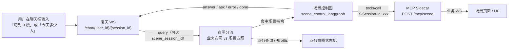

# UE 3D 场景控制接入说明（Agentic App 侧）

> 对应代码：
> `mcp_client/scene_mcp_client.py`、`graph/scene_control_langgraph.py`、`app.py`（场景分支）。
> 目标：前端在 3D 场景页面里用自然语言发指令，后端选工具 → MCP sidecar → sidecar 通过
> 自己的 WebSocket 把动作帧推给场景页面 → UE 执行。

---

## 1. 链路

场景控制**不是单独的选项卡**：它和业务查询共用同一个聊天入口，由后端自动识别。



两个 WS 是独立的：

- **场景页 ↔ sidecar**：前端已实现，`hello` 时声明自己的 sessionId；
- **聊天 UI ↔ Agentic App**：只需发自然语言，后端负责判断这句话是场景指令还是业务查询。

---

## 2. 最小示例：怎么发一条指令

连接 `ws://<后端地址>:<端口>/chat/{user_id}/{session_id}`（端口按启动参数，示例用 8000；
仓库自带的 `web/` 默认连 8001），发送：

```json
{ "query": "切到3楼" }
```

是的，只需要 `query`。后端会自动识别成场景指令并走场景图，返回体与业务问答一致。

如果要指定动作帧推给哪个场景页面（多页面场景），再带上场景页的 sessionId：

```json
{ "query": "切到3楼", "scene_session_id": "前端场景 WS 里 hello 的 sessionId" }
```

字段说明：

| 字段 | 必填 | 说明 |
|---|---|---|
| `query` | 是 | 自然语言，场景指令/业务查询都可以 |
| `scene_session_id` | 否 | 场景页面会话 id，逐请求注入 `X-Session-Id`；不带则走 sidecar 单场景会话兜底 |
| `mode` | 否 | 显式强制：`"scene"` 跳过意图识别直接进场景图，`"kb"` 走知识库。**正常使用不需要** |

> `scene_session_id` 也兼容 `sceneSessionId` / `sceneId` / `scene_id` / `X-Session-Id` / `x_session_id`。
> 前端字段如果不同，改 [app.py](../app.py) 的 `_extract_scene_session_id()` 一处即可。

### JavaScript

```js
const ws = new WebSocket(`ws://10.204.146.44:8000/chat/${userId}/${chatSessionId}`);

ws.onopen = () => {
  ws.send(JSON.stringify({ query: "切到3楼" }));
};

ws.onmessage = (e) => console.log(JSON.parse(e.data));
```

### Python

```python
import asyncio, json, websockets

async def main():
    async with websockets.connect(f"ws://10.204.146.44:8000/chat/u1/chat-001") as ws:
        await ws.send(json.dumps({"query": "切到3楼"}, ensure_ascii=False))
        while True:
            msg = json.loads(await ws.recv())
            print(msg)
            data = msg.get("data") or {}
            if msg.get("status") == "done" or data.get("type") in ("done", "ask", "error"):
                break

asyncio.run(main())
```

### 用自带 web 页面快速试

打开 [web/index.html](../web/index.html)，直接输入即可（「智能体问答」模式下）：

1. 场景指令：切到 3 楼、换到 B1、查看设备、看监控、三楼摄像头、显示访客轨迹、
   显示巡检路线、显示三楼的会议室、显示食堂位置、显示周界防区总览、改成傍晚、
   换成下雨、场景状态；
2. 业务查询：今天园区有多少人、消防告警、今天有哪些会议、查看设备运行情况、
   各防区告警统计……
3. 两类指令在同一个输入框里混着发，后端自动识别。

预置指令走的是同一套 `data-query` chip 机制，请求体只带 `query`，没有场景专用模式。

---

## 3. 什么情况下会走场景图

**先于**人员/安防等业务意图状态机，按以下顺序判断：

| 条件 | 说明 |
|---|---|
| `payload.mode == "scene"` | 显式强制（脚本/联调），正常聊天不需要 |
| 上一轮场景指令正在等参数 | 追问态，用户下一句直接回答参数即可；若明确切到别的业务域则放弃追问 |
| 自动识别命中 | 见下面的判定规则，前端无需任何标记 |

自动识别规则（`agent/intent/classifier.py` 的 `should_route_scene`）：

1. **业务查询句式优先**（`is_business_query`）：
   - 「查询/查看 xx 情况、xx 数据、xx 统计」以及问句（`吗/呢/？/什么/多少/
     哪些/第几/没…`）一律归业务；
   - 例外：问场景自身状态的句子（「现在场景在第几层」「当前楼层是几楼」）
     仍归场景；
   - 「查询/查看 + 数据词」可以压过场景展示动作（「查看三楼的监控数据」
     归业务；「显示三楼的监控数据」是展示动作，仍归场景）。
2. **明确场景动作 / 查看场景对象**直接走场景（不要求场景分过阈值）：
   - `场景/视角/弹窗/融合/聚焦/镜头`、
     `切到/转到/换到/换成/回到 …楼`、`重置视角`、`清场`、
     `显示/隐藏 …点位`、`显示 …会议室/食堂/巡检/防区/轨迹/路线/位置/总览`、
     `查看/看 xx 设备/摄像头/监控/画面/点位/…`、`改成傍晚/下雨` 等；
   - 其中明确动作（「显示/切到…」）优先于问号；纯查看对象的问句
     （「查看设备吗」「监控画面正常吗」）仍归业务。
3. 业务意图没命中（低于业务阈值，判为 `other`）且场景分 ≥ 0.60 → 走场景；
4. 业务域也命中时，场景分比业务分高出 `SCENE_ROUTE_MARGIN`（0.05）才走场景；
5. 否则维持业务查询——「摄像头在线率」「各防区告警统计」「整栋楼有多少人」
   「查看设备运行情况」「今天有哪些会议？」这类问法不会被场景通道截胡；
6. 业务追问中的简短补参（如「3楼」「A-01」）默认交回业务追问，
   除非本轮是明确的场景操作；
7. `scene.url` 未配置时自动识别自动关闭，只保留显式 `mode=scene`。

> 注意：场景页的 sessionId 不再是分流的必要条件；它只决定动作帧推给哪个页面。

---

## 4. 能说哪些指令

20 个工具由 sidecar 的 `tools/list` 动态提供给 LLM，措辞不限；下面只是常见说法。
（`llm=None` 时走规则兜底，支持的说法会窄一些。）

| 想做什么 | 示例说法 | 工具 |
|---|---|---|
| 切楼层 | 切到 3 楼 / 去 B1 / 回到整栋楼 | `scene_switch_floor` |
| 视角 | 重置视角 / 恢复上一个视角 | `scene_reset_view` / `scene_recover_view` |
| 关详情 | 关闭弹窗 | `scene_close_detail` |
| 清场 | 把刚才打开的都关掉 | `scene_reset_all` |
| 访客 | 看一下 A 栋的访客轨迹 | `scene_show_visitor_track` |
| 监控 | 看 CY-HIK-JK-001 的监控 | `scene_show_camera`（需要 tag） |
| 巡检展示 | 显示三楼巡检路线 | `scene_show_inspection` |
| 会议室 / 食堂 | 显示三楼的会议室 / 食堂位置 | `scene_show_meeting_rooms` / `scene_show_dining` |
| 防区总览 | 展示周界防区 | `scene_show_area_overview` |
| 设备类目点位 | 显示 3 楼所有烟感 / 门禁点位 | `scene_show_device_category` |
| 虚实融合 | 把 CY-HIK-JK-001 融合到场景里 | `scene_show_fusion`（需要 tag） |
| 聚焦 / 显隐 | 聚焦到这台设备 / 隐藏这个点位 | `scene_focus_actor` / `scene_set_actor_visible` / `scene_set_poi_visible` |
| 环境 | 改成傍晚 / 下雨 | `scene_set_env` |
| 防区布撤防 | 把 A-01 防区撤防 | `scene_set_area_state`（破坏性，默认服务端禁用） |
| 巡检任务 | 开始 / 暂停 / 结束巡检任务 A | `scene_set_inspection_state`（破坏性，默认服务端禁用） |
| 查状态 | 现在场景在第几层 | `get_scene_state` |

每条指令都会先调一次 `get_scene_state` 拿场景快照，作为 LLM 规划上下文。

> `scene_set_env` 的 `env_weather` 是**枚举参数**，只接受
> `晴天|多云|阴天|小雨|中雨|大雨|暴雨|雷阵雨|雾|小雪|中雪|大雪|暴雪|雨夹雪`。
> 说“下雨 / 下雪 / 放晴”会自动收敛成“小雨 / 小雪 / 晴天”；枚举外的说法
> （例如“下冰雹”）不会下发，而是追问用户想要哪种天气。

---

## 5. 后端返回什么

### 成功下发

```json
{"event":"custom","data":{"type":"answer","content":"已下发动作 scene_switch_floor（floor=3, focus=true）。\n注意：这只代表动作帧已送到场景页面，UE 不回执，不代表场景已经改变。"}}
{"event":"custom","data":{"type":"done"}}
```

回答只会说 **“已下发”**，不会说“已完成”——UE 不回执，后端无法确认场景真的变了。
sidecar 返回文本里“回复用户时不要说已完成”这类内部提示已被 `_clean_scene_text()` 清掉。

### 需要补充参数（多轮）

```json
{"event":"custom","data":{"type":"ask","question":"执行“监控画面”还缺少：点位/对象标识。请补充一下。","ask_count":1}}
```

下一轮**只发补充内容即可**，不用再带任何模式标记（多场景页面时建议继续带 `scene_session_id`）：

```json
{"query":"CY-HIK-JK-001"}
```

后端会把上一轮首问和本轮回答拼起来重新规划，首问原话不会被拼接串滚雪球。

### 失败

```json
{"event":"custom","data":{"type":"error","content":"场景指令下发失败：调用 scene_set_area_state 失败：该工具默认禁用"}}
{"event":"custom","data":{"type":"done"}}
```

工具级失败（`isError=true`）**不会重试**，避免动作重复下发。

### 与其他模式的区别

- 场景分支只发 `{"event":"custom","data":{"type":"done"}}`，**不发** `{"status":"done"}`
  （与各业务域图的收尾口径一致）；
- 追问轮发 `ask`，不发 `done`，前端据此解锁输入框等待下一句。

---

## 6. 日志与自检

服务端日志里能看到分流判定和调用过程：

```
[classify_intent_with_scene] query=切到3楼, intent=other, score=0.41, scene_score=0.78, scene_matched=True
[场景分流] query=切到3楼, business=other(0.4100), scene=0.7800, matched=True, route=True
场景 MCP 握手成功: http://10.204.146.44:2222/mcp/scene ... sessionId=xxxxxxxx...
[SCENE GRAPH INPUT] user=..., scene_session=...
[SCENE MCP CALL] tool=scene_switch_floor, args={'floor': 3, 'focus': True}, x_session_id=...
[SCENE MCP RAW RESULT] tool=scene_switch_floor, result=已下发动作 ...
[SCENE GRAPH OUTPUT] ...
```

排查顺序：

1. 没有 `[SCENE GRAPH INPUT]` → 没进场景分支：看 `[场景分流]` 日志里的
   `business/scene/matched/route`；场景分不够或业务分更高时会维持业务查询；
2. 业务问法被误判成场景 → 检查 `is_business_query` 是否覆盖了该数据词/问句，
   或补充业务域语料；反向误判则收紧 `_SCENE_STRONG_CUES` / `_SCENE_VIEW_CUES`；
3. `场景服务未配置或不可用` → `mcp_server_config.yaml` 的 `scene.url` 为空或 sidecar 没起
   （未配置时自动识别会自动关闭）；
4. 有 `[SCENE MCP CALL]` 但 `x_session_id=None` → 聊天 payload 没带会话 id，sidecar 会走单会话兜底（多页面时会推错页面）；
5. 回答“已下发”但场景没动 → 看 sidecar 与场景页日志；动作可能被破坏性开关拦截，或场景页 WS 已断开。

---

## 7. 配置与部署

`mcp_client/mcp_server_config.yaml`：

```yaml
scene:
  transport: streamable_http
  url: http://10.204.146.44:2222/mcp/scene
  direct_client: true      # 不走 langchain_mcp_adapters，由 SceneMcpClient 直连
```

- 地址也可用环境变量 `SCENE_MCP_URL` 覆盖，优先级高于 yaml；
- 客户端超时 25s（必须大于 sidecar 的 `scene.action-timeout-ms` 15s）；
- `/mcp/scene` 无认证；`X-Session-Id` 只由后端注入，**LLM 不接触也无法生成**；
- 场景图懒加载、客户端的 MCP 握手也懒建立：sidecar 没起不影响服务启动，只影响场景指令。

单元测试（不依赖 sidecar）：

```bash
pytest tests/test_scene_routing.py tests/test_scene_mcp_client.py tests/test_scene_control_graph.py -v
```
